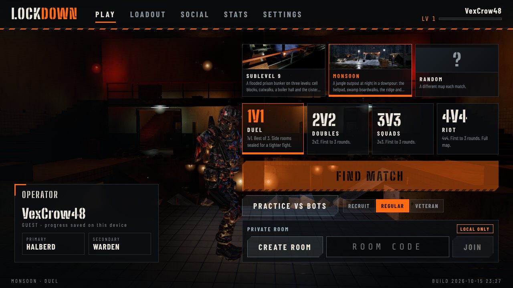
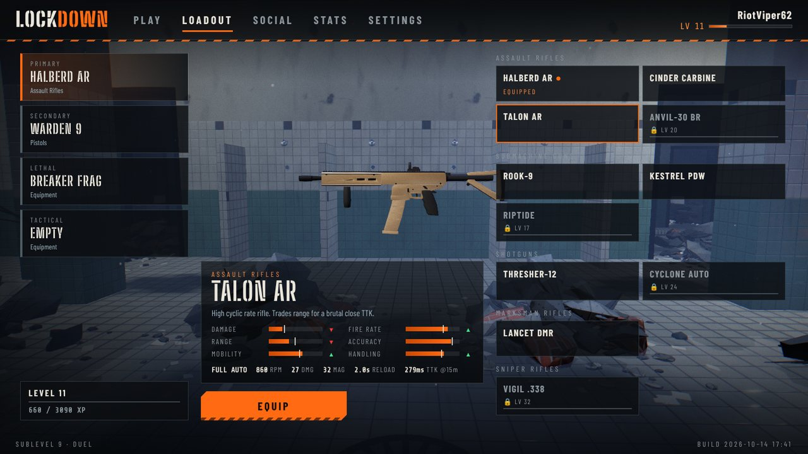
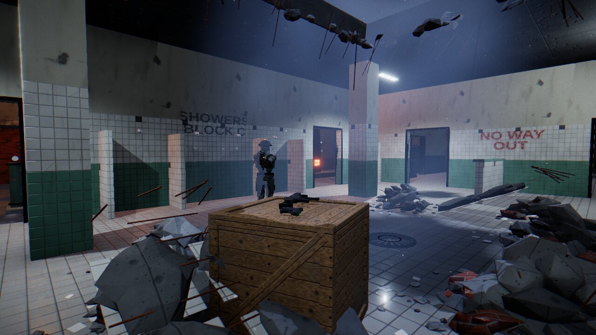
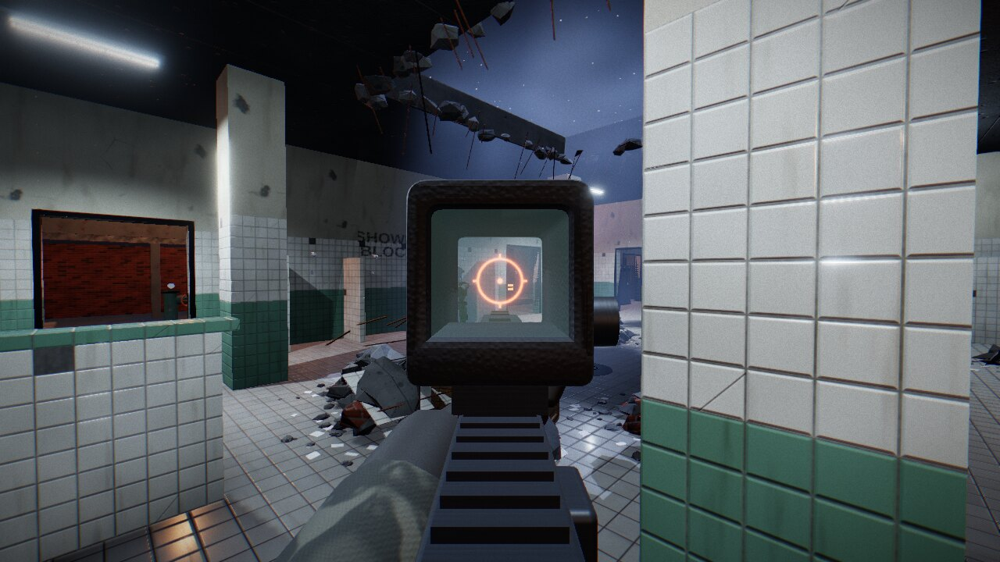
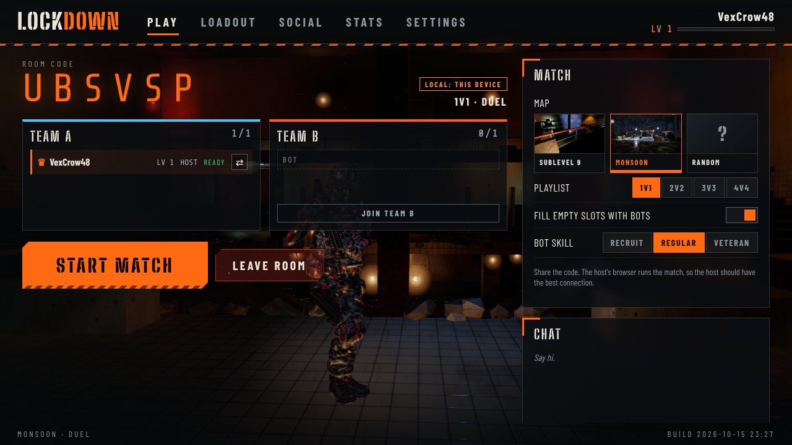
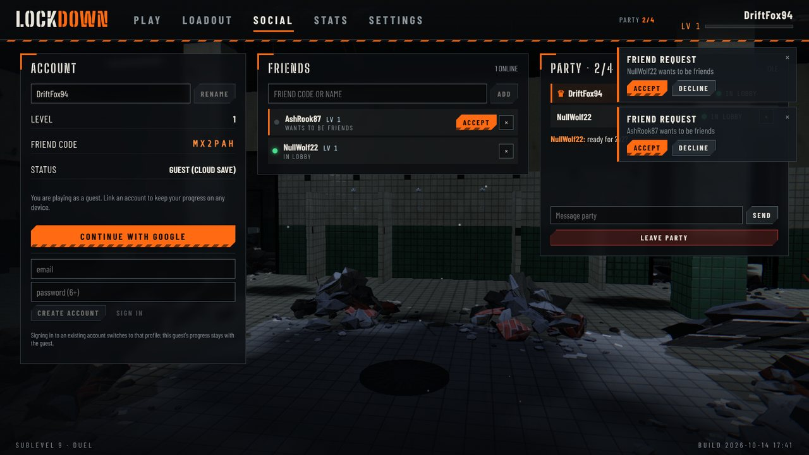

# LOCKDOWN

**A fast, round-based arena shooter that runs in your browser.** Two teams (1v1 up to 4v4) fight
in *Sublevel 9*, a flooded prison bunker of tiled showers, cell blocks, locker rooms and a boiler
hall. Last team standing takes the round. If the clock runs out, a capture point opens over the
central drain: hold it to win. Everything you see and hear (textures, weapons, operators, the map,
every gunshot) is generated in code at load time.

**Play:** <https://jacobkalka.github.io/Gulag/> (live once the steps in [SETUP.md](SETUP.md) are done)

| | |
|---|---|
|  |  |
|  |  |
|  |  |

## Features

**Gameplay**
- Full movement: walk, sprint (latch or hold), crouch, slide, jump, mantle onto ledges.
- 15 original weapons (pistols, SMGs, assault/battle rifles, shotguns, DMR, sniper, LMG) with ADS
  zoom and sway, recoil patterns, spread/bloom, magazine and shell-by-shell reloads, swap, and melee.
  Every stat lives in [`src/data/weapons.ts`](src/data/weapons.ts).
- Frag and flash grenades.
- Playlists 1v1 / 2v2 / 3v3 / 4v4 (adding 5v5 is one entry in `src/data/playlists.ts`).
- Rounds, overtime capture, sudden death, spectating teammates, kill feed, end screen with
  stats and an XP breakdown.
- Bots that use cover, peek, hunt, take the objective and throw grenades (three difficulties).

**Online**
- Accounts: guest by default with cloud saves, upgrade to Google or email/password without losing
  progress. Unique usernames and friend codes.
- Friends with requests and live presence (in lobby / in a room / searching / in match).
- Parties of up to four with invites and party chat. Members follow the leader into rooms.
- Matchmaking per playlist; empty slots are filled with bots after a short wait.
- Private rooms with a 6-character code: teams, bot fill and skill, ready-up, chat, kick.
- Host-authoritative netcode over WebRTC data channels with client-side prediction, reconciliation,
  100 ms interpolation and lag-compensated hits.

**Progression**
- XP from kills, headshots, assists, captures, rounds and wins; 50 levels; weapons and equipment
  unlock along the way. The loadout screen has a live 3D turntable and stat bars compared with what
  you carry. Practice against bots pays 50%.
- Online XP is claimed from the host's match record and checked by the database security rules.

**Presentation**
- three.js WebGL2 renderer with GTAO-style SSAO, bloom, ACES tone mapping, SMAA, motion blur,
  volumetric light shafts, a reflection probe for the wet floors, and dynamic lights.
- Quality presets (Low → Ultra), resolution scale, FPS/ping overlay.
- Positional HRTF audio synthesized at load, with separate volume sliders.
- Accessibility: colorblind team palettes, directional captions for important sounds, reduce-motion
  mode, HUD scale, crosshair editor, full key rebinding, toggle/hold options, basic gamepad support.

## Controls

| Action | Default |
|---|---|
| Move | W A S D |
| Look / fire / aim | Mouse / left button / right button |
| Sprint | Shift (tap to latch) |
| Crouch / slide | C or Ctrl (slide while sprinting) |
| Jump / mantle | Space |
| Reload / swap / melee | R / Q or mouse wheel / V |
| Frag / flash | G / F |
| Scoreboard / pause | Tab / Esc |

Gamepad (standard mapping): sticks move and look, RT fire, LT aim, A jump, B crouch, L3 sprint,
X reload, Y swap, R3 melee, RB frag, LB flash. Desktop browsers with a mouse are the target; on phones and
tablets the game shows a "desktop recommended" note.

## Running it

```bash
npm ci
npm run dev        # http://localhost:5173
```

Without any configuration the game runs offline: practice vs bots, local guest progress, and private
rooms between browser tabs on the same device. Online play needs a free Firebase project; deployment
uses GitHub Pages. [SETUP.md](SETUP.md) has the click-by-click steps, the TURN relay option and how to
use the local Firebase Emulator Suite.

```bash
npm test             # simulation, bots, netcode over a simulated lossy network
npm run test:rules   # Firestore + RTDB security rules against the emulators (Java 11+)
npm run e2e          # two browser tabs play a match over real WebRTC
npm run build        # static site in dist/
npm run balance      # time-to-kill table per weapon, range and hit zone
```

Scene audits run the real game in headless Chromium (a dev server is started if none is running):

```bash
npm run audit:shadows    # every mesh casts and receives shadows, or states why not
npm run audit:textures   # every lit material has albedo + normal maps, or states why not
npm run audit:contrast   # luminance histograms from fixed cameras: flat, crushed or blown out fails
```

Developer views: add `?perf` to the URL for a frame-time, draw-call, triangle, light and memory
overlay; `#/arttest` renders the map from fixed cameras (`cam=free&pos=x,y,z&look=x,y,z` for any
view); `#/swatches`, `#/swatches/decals` and `#/swatches/props` show every material, decal and prop
variant.

The architecture, protocol and data model are described in [PLAN.md](PLAN.md); the upgrade plan and
its checklist are in [UPGRADE_PLAN.md](UPGRADE_PLAN.md). Assets and licenses are listed in
[CREDITS.md](CREDITS.md).

## Known limitations

- **Trust model.** There is no game server: the host's browser runs the match. Clients only send
  inputs and the host validates them (one input per tick, sanitized values, host-side fire rate,
  ammo and damage), but a player who *hosts* with a modified client can cheat in that match.
  XP claims are checked against the host's match record (formula cap, plausibility bounds,
  one claim per match, a minimum match length and a per-player claim rate limit), which bounds how
  much a cheating host can farm. Preventing it fully needs a dedicated server.
- **Host leaves = match ends.** There is no host migration. Clients who leave are replaced by bots.
- **Connectivity.** Peer-to-peer needs NAT traversal. Most networks work with STUN; strict ones need
  the optional TURN relay (SETUP.md §8). TURN credentials in a static site are visible to players,
  so use domain-restricted or short-lived ones.
- **Matchmaking** is coordinated by the clients in the queue (oldest ticket hosts). It has no skill
  rating, and players must keep the tab open while searching.
- **Lag compensation** favors the shooter up to 250 ms, so with a high ping you can occasionally be
  hit just after reaching cover.
- **Offline progress** (no Firebase configured) lives in localStorage and is not validated.
  An anonymous guest who clears browser data loses that account unless it was linked.
- **One map** (Sublevel 9). The map format is data-driven, so more can be added.
- **No voice chat**, no player blocking or reporting, no kill cam (spectating your killer briefly
  instead).
- **Performance** was profiled for draw calls and triangles, but real-GPU frame rates were not
  measured in the build environment (it only has a software renderer). Integrated GPUs should use the
  Low or Medium preset. Mobile is not a target.
- Sound is fully synthesized: stylized rather than recorded realism.
