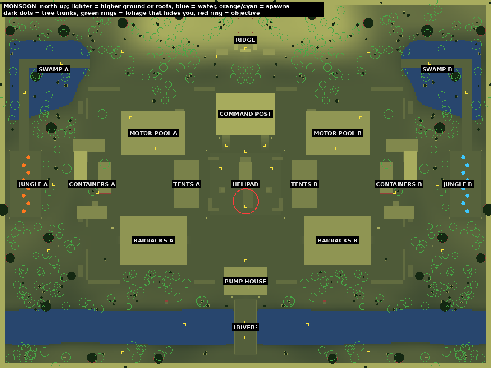

# Monsoon

A jungle military outpost at night in a tropical downpour. Outdoor, wet, very dark, full of plants
and trees: buttress giants hung with lianas, tree ferns, palms, bananas, a fern carpet and
boardwalks through the swamps. Mirrored across x = 0: team A starts in the west jungle, team B in
the east. Built by `src/game/world/monsoon.ts`; bot results in
[monsoon-botsim.md](monsoon-botsim.md).

- Play space 96 m x 72 m. The ground and a dense band of jungle carry on 12-14 m past the walls,
  so no view ends at an open horizon (that band is scenery only).
- Terrain (a 1 m heightfield): the base pad at 0 m, swamp hollows down to about -0.75 m under
  standing water, the river channel along z = -28 (water at -0.85 m), and the ridge along the
  north edge rising to about +4 m.
- Overtime objective: the **helipad** in the middle of the base, around the wrecked helicopter
  (2.5 m capture radius).

## Zones

| Zone | Light | Character |
|---|---|---|
| JUNGLE A / B (spawns) | team-tinted lanterns on the spawn platform, a lantern where the south trail leaves the clearing, fireflies | buttress giants, tree ferns, palms, ferns; a boardwalk platform in a clearing |
| SWAMP A / B | lanterns on posts along the boardwalk (one gutters) | flooded hollows crossed by a boardwalk up toward the ridge: the north flank |
| CONTAINERS A / B | a floodlight on a pole | containers, one stacked two high; crates to climb onto the low ones |
| BARRACKS A / B | warm windows, lanterns by both doors | long huts on a low floor with a door at each end, bunks inside |
| MOTOR POOL A / B | a jeep with its headlights on, a caged lamp under the tarp | a truck, a jeep, fuel drums and a generator under a canvas tarp |
| TENTS A / B | a lantern | canvas tents: they hide you but don't stop bullets |
| HELIPAD | floodlights on poles at the corners (one of them dead), embers in the wreck | the wrecked helicopter, sandbag corners, crates: the objective |
| COMMAND POST | glowing windows, a lantern, a red beacon on the radio mast | a hut on stilts with a porch overlooking the helipad |
| RIDGE | the watchtower's sweeping searchlight | the high ground and a sandbagged MG nest |
| RIVER / BRIDGE / PUMP HOUSE | sodium lamp posts at the bridge, the pump house lamps, a fire in a drum on the bank either side of the bridge | a wading river, a wooden bridge, a concrete pump house |

## Routes and balance

- Center: jungle, the west gate, containers or tents, the helipad.
- North: swamp boardwalks to the ridge, then down past the command post.
- South: along the river bank to the bridge and the pump house, then up to the helipad.
- Cover comes in two kinds: hard (containers, huts, vehicles, sandbags, tree trunks) stops
  bullets; soft (bushes, bananas, monstera, tents) only hides you. Bots work the same way:
  foliage blocks their sight (`canSee` treats it as concealment) but not their bullets.
- Ranges: long across the helipad, from the ridge and along the river; medium around the
  barracks and motor pools; close in the jungle, the swamps and among the containers.
- Bot-vs-bot (89 rounds over all playlists): 48% / 52% between the sides, first contact after
  about 5 s, most fights in the base. One bot that kept trying to reach cover under the bridge
  was fixed by closing the gap under the deck.

## Light and weather

- The moon lights only the cleared base (a far, soft-edged spotlight with shadows). Under the
  canopy the jungle gets the overcast sky and the moon as baked light, dimmed by the crowns
  overhead (`src/game/view/canopy.ts`): dark on purpose, the flashlight matters there.
- Heavy rain: streaks in a box around the camera that stop under roofs, every surface wet
  except under cover (the wet mask's roof heights), puddles on the concrete.
- Lightning now and then flashes the sky and the whole scene; storm clouds drift; fog thickens
  the distance.
- Grade: muted greens (saturation 0.92), cool shadows, warm lanterns.

## Performance

- Every plant is an instance in one of four BatchedMeshes (one draw call per material per pass,
  culled per plant). Ground cover is not drawn beyond 34 m and thins out on lower quality
  (`foliage` in the quality presets); trees cast shadows only from the moon.
- On Low and Medium the moon's shadow map renders once (players cast moon shadows on High and
  Ultra). Static batches use 32 m chunks outdoors to keep shadow passes cheaper.
- Medium quality, from the spawn: about 390 draw calls and 1.0 M triangles a frame.
