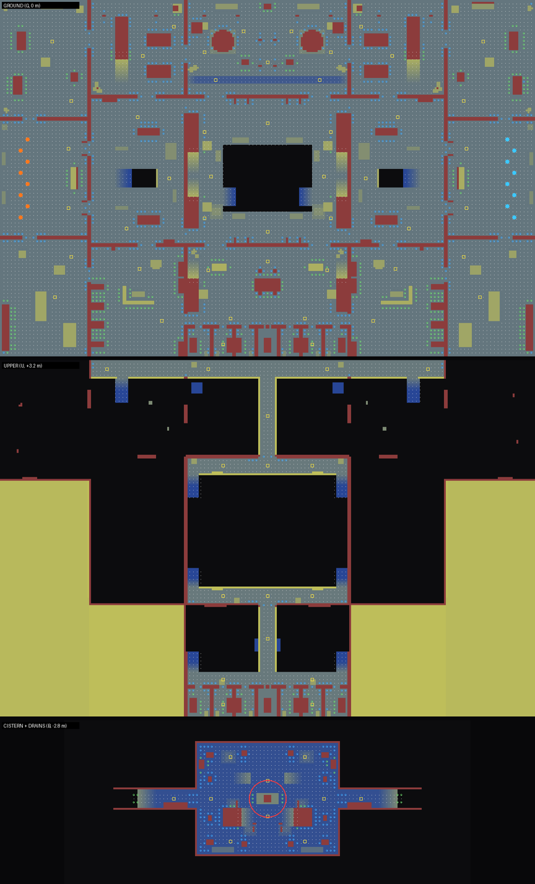

# Sublevel 9

A flooded prison bunker on three levels. Indoor, dark, wet. Mirrored across x = 0: team A
spawns west, team B east. Built by [`src/game/world/sublevel9.ts`](../../src/game/world/sublevel9.ts).

- Footprint 72 m x 48 m (3,456 m²), about twice the old 50 m x 34 m layout, plus the cistern
  and drain level underneath.
- Levels: **B** cistern and drains at -2.8 m, **G** main floor at 0, **U** catwalks, balconies
  and the upper cell tier at +3.2 m.
- Overtime objective: the **cistern** floor under the collapse, at (0, -2.8, 0).

## Layout

North is up (+z). Coordinates are in meters.



The image is drawn from the collision world and the bot nav grid. Floor color shows height, red
is blocked, white dots are nav nodes and circles are cover spots. Yellow squares are the bots'
points of interest, team spawns are orange and cyan, and the red ring is the objective.

### Ground floor (G, y = 0)

```
 z=+24 +----------+-------------+-------------------------------+-------------+----------+
       |          | GENERATORS A|          BOILER HALL          |GENERATORS B |          |
       | PUMP     |  gen   gen  |   boiler  ~trench~  boiler    |  gen   gen  |   PUMP   |
       | ROOM A   |   [stairs]  |      ||   spine (U)  ||       |  [stairs]   |  ROOM B  |
       |  pumps   D             D=====  over the hall  =====D             D  pumps   |
 z=+11 |          +-----D-------+-----[ ]------------[ ]------+------D------+          |
 z=+8  +---D------+             |   north balcony (U) above   |             +------D---+
       |          D             D  ^stairs   +--------+  ^    D             D          |
       | INTAKE A |  LOCKERS A  |  |         |COLLAPSE|  |    |  LOCKERS B  | INTAKE B |
       |  >> spawn|  [drain v]  |  split     |  PIT   |split  |  [v drain]  |spawn <<  |
       |          D             |  stairs    |  to B  |stairs |             D          |
 z=-8  +---D------+             |  v         +--------+  v    |             +------D---+
 z=-9  |          +-----D-------+-----[ ]------------[ ]------+------D------+          |
       | LAUNDRY  |  INFIRMARY A|        CELL BLOCK 9           | INFIRMARY B |  LAUNDRY |
       |    A     D   station   D  [stairs]  gantry  [stairs]   D   station   D    B     |
       |          |   beds      |  booth   cells C01-C07 (G+U)  |   beds      |          |
 z=-24 +----------+-------------+-------------------------------+-------------+----------+
     x=-36      x=-24         x=-11                           x=+11         x=+24      x=+36
```

`D` doors, `[ ]` 3 m openings between the collapse and the halls, `~trench~` the 0.6 m deep
drainage channel. The doors between each intake and its pump room and laundry, between each pump
room and its generator room, and between each laundry and its infirmary are shuttered in **1v1**.
That seals off the four outer rooms and keeps a duel tight.

### Upper level (U, y = +3.2)

```
 z=+24 +----------------- catwalk (north wall, both generator rooms) -----------------+
       |  [stairs up from the generator rooms]                                       |
       |                              spine                                          |
 z=+11 |                    +-----  north balcony  -----+                            |
       |                   stairs    (over the pit)    stairs                        |
 z=-9  |                    +-----  south balcony  -----+                            |
       |                              gantry                                         |
 z=-18 |           [stairs] ======== gallery ======== [stairs]                       |
 z=-24 |                    upper cells C01-C07                                      |
```

### Cistern and drains (B, y = -2.8)

```
            DRAIN 2A (under LOCKERS A)        CISTERN (under the collapse)        DRAIN 2B
 [stairs up]========================[   pillars    pump+riser    pillars   ]========================[stairs up]
                                     under-ledge  ramps up to G  under-ledge
```

The cistern is 19 m x 15 m. The middle 12 m x 9 m is open to the collapse above. The rim around
it is a 2.4 m high crawl space under the broken floor, with pillars. Shallow water covers
the whole level.

## Zones and callouts

Each zone has its own light, so players learn the map by color. The HUD names the zone on spawn and
whenever you walk into a new one.

| Zone | Light | Character |
|---|---|---|
| INTAKE A / B (spawns) | warm cages + an orange (A) or cyan (B) team lamp | check-in counter, metal detectors |
| LOCKERS A / B | cold buzzing fluorescents | locker islands, the drain stairwell |
| PUMP ROOM A / B | warm tungsten cages | pumps, pipes, crates |
| GENERATORS A / B | amber rotating beacons | generators, freestanding stairs to the catwalk |
| INFIRMARY A / B | cold green-white tubes, one dead | beds, curtain rails, nurse station |
| LAUNDRY A / B | cool tubes | washers, folding tables |
| BOILER HALL / TRENCH | sodium pendants, furnace glow | two boilers, the drainage trench |
| CATWALK / SPINE | sodium spill from below | the high route across the north |
| COLLAPSE | moonlight through the broken roof, red emergency lamps | the pit, split stairs |
| NORTH / SOUTH BALCONY | red emergency lamps | overlook the pit |
| CISTERN | green-cyan sump lamps | the objective, pump housing and riser |
| DRAIN 2A / 2B | dim green emergency light | the low route |
| CELL BLOCK / GALLERY / GANTRY | warm cages, many dead | two tiers of cells, guard booth |

## Routes

- **Middle:** intake, lockers, then a corner door into the collapse. The direct route, and the
  first contact in most rounds.
- **North:** intake, pump room, generators, then the boiler hall floor or the catwalk.
- **South:** intake, laundry, infirmary, then the cell block floor or the gallery.
- **High:** generator stairs up to the catwalk, spine and north balcony, or cell-block stairs up
  to the gallery, gantry and south balcony. The split stairs in the collapse join the high route
  to the main floor.
- **Low:** the drain stairwell in each locker room down to the drain, which comes out in the
  cistern's crawl space. The quickest way onto the objective, and a trap if someone waits at the
  mouth.

Loops: every room has at least two exits, the balconies join both high routes over the pit, and
the pit has a rubble ramp on each side and drop-downs all round. No fall damage.

## Power positions and counters

| Position | Strength | Counter |
|---|---|---|
| North / south balcony | sees the whole pit and the collapse floor | open to the other balcony, the spine/gantry and both stair heads; the steel plates only cover a crouch |
| Pit rim | high ground over the objective | open from the balconies and the far rim; curbs only cover a crouch |
| Spine / gantry | crosses a whole hall high up | narrow, railings don't stop bullets, open to both ends |
| Catwalk | long sightline over the boiler hall | exposed from the hall floor and both generator rooms |
| Drain mouth | holds the low route | grenades bounce down the stairs, and it is blind to the cistern behind |

## Cover and ranges

- Cover comes in three heights: crouch (benches, curbs, the trench, steel plates, the pump housing);
  chest (counters, the guard booth, fallen lockers, crates); full (locker islands, pillars,
  boilers, generators, walls).
- Long range: the boiler hall (22 m across), the catwalk, the cell block corridor and the collapse.
- Medium range: lockers, generators, pump rooms.
- Close range: cells, drains, laundry, infirmary, the crawl space.

## Spawns and fairness

- Eight spawns per side in each intake (1v1 up to 4v4 and beyond), 66 m apart, with spawn
  protection.
- The layout is mirrored, so geometry is fair by construction. A symmetry check over the
  collision world finds 741 primitives, all mirrored except 8 thin pipe colliders on props.
- Bots learn the map from a 0.5 m multi-level nav grid (about 12,900 nodes, one connected
  area). Each round, teammates spread over the five routes, and both sides take mirrored ones.

## Bot simulation

`npm run botsim -- sublevel9 12` plays 12 headless bot matches per playlist, with every bot on
Regular. It reports wins per side, time to first contact, stuck bots, where fights happen and
which zones bots never reach. Latest results: [`sublevel9-botsim.md`](sublevel9-botsim.md).

## Changelog

- **Upgrade M5:** rebuilt from the 50 m x 34 m single-floor layout into three levels at about twice
  the size. Added the cistern objective, the drains, catwalks, balconies, the gallery and
  gantry, the generator rooms and infirmaries, zone callouts and bot routes.
